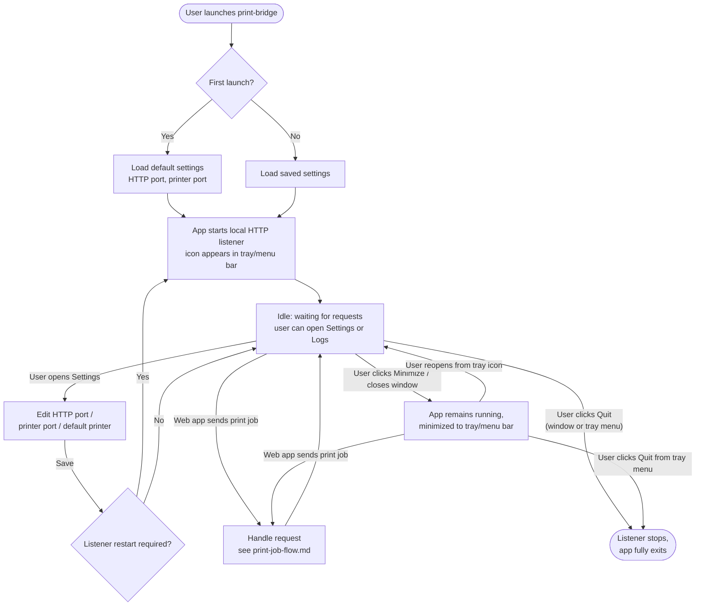

# Process — User Workflow

This describes the end user's lifecycle with the print-bridge application itself, independent of any single print job. See `05-ux/tray-app-spec.md` for exact UI states and screens.

## App lifecycle

## Key behaviors to preserve

- **Minimizing keeps the listener alive.** A web app can still print while the window is minimized to the tray — this is the whole point of running it as a tray-capable app rather than a plain window.
- **Quitting is a deliberate, explicit action.** There is no auto-start and no "close = quit" ambiguity: closing the window minimizes; only Quit (from the window or the tray menu) actually stops the listener and exits the process. This must be visually unambiguous in the UI — see `05-ux/tray-app-spec.md`.
- **Saving Settings restarts the listener** so the saved destination, ports,
  origins, and preview preferences take effect without requiring the user to
  quit and relaunch.
- **Job payload history is not persistent.** Settings and rotating request logs persist locally; full print payload history does not need to survive application restarts.

## Virtual Mode workflow (implemented)

Tracked with integration evidence and native release follow-up in the
[Virtual Mode sprint record](../08-backlog/virtual-mode-sprint.md).

1. Open Settings, select Virtual, optionally enable Labelary rendering and set
   label dimensions/density, then Save.
2. Use Open Inspector to open the local dashboard in the system browser.
3. Submit an existing JSON text request from an allowed web origin; the virtual
   destination captures it even if a physical hostname was supplied.
4. Inspect text/hex or download the original payload. If enabled and online,
   view the ZPL preview; failures can be retried without resubmitting the job.
5. Clear history as needed. Closing the inspector does not stop capture.
6. Switch back to Physical to resume physical printing for new requests.
   Existing captured jobs are never replayed automatically.
7. Quit the app to stop the listener, cancel render work, and discard captured
   payloads/previews. Settings and metadata logs retain their existing storage.

Listener restarts during settings changes keep session history. Browser tabs
using an old HTTP port show disconnection and can be reopened from the app.
