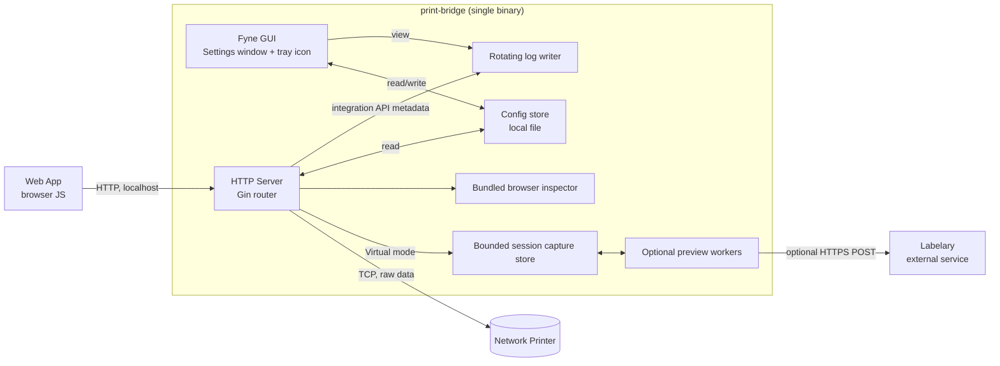
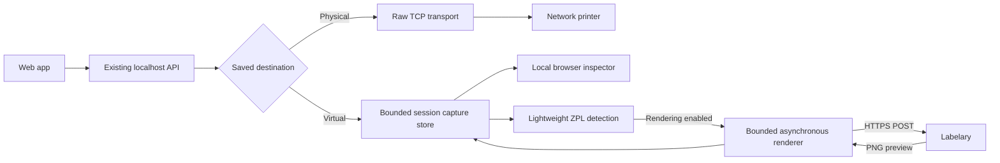

# Architecture Overview — print-bridge

Read `01-business/constraints.md` and `03-architecture/decisions.md` alongside this document. This file describes *what* to build; `decisions.md` records *why* specific alternatives were rejected.

## Components

## Tech stack

| Layer | Choice | Rationale |
|---|---|---|
| Language | Go | Existing backend prototype is already Go; single language for the whole app keeps this maintainable by one person. |
| HTTP server | Gin (already in use) | Proven in the existing prototype; no reason to replace working code. |
| GUI / tray | Fyne | Native cross-platform Go GUI with built-in system tray support; single compiled binary, no embedded browser/webview dependency. See conversation rationale — chosen over Wails to avoid a WebView2 runtime dependency on Windows and because Fyne's tray support is more mature. |
| Config storage | Local file (see `06-config/config-schema.md`) | No external database; matches "few moving parts" constraint. |
| Logging | Rotating local file (e.g. `lumberjack`-style rotation) | Self-service diagnosis for users without a support team (BR-8). |
| Distribution | GitHub Releases + Actions (existing) | No paid infrastructure; matches budget constraints. |

## Runtime model

print-bridge runs as a **single process** containing both the GUI (Fyne) and the HTTP server (Gin), on one goroutine tree:

- The HTTP server runs in its own goroutine, started when the app launches and stopped when the user quits.
- The GUI event loop runs on the main thread, per Fyne's requirements.
- Settings changes that affect the listener (HTTP port, default printer) trigger a clean stop/restart of the HTTP server goroutine, not a full app restart.

This is a deliberate simplification over running the HTTP agent as a separate background process from the GUI — one process is easier to reason about, easier to install/uninstall cleanly, and there's no auto-start requirement (see `decisions.md`) forcing a headless-service split.

## Key architectural values

- **Fail fast, not silently.** Every network operation (TCP connect, write) must have an explicit timeout. See timeout values below.
- **Few moving parts.** No database or background service registration. The
  dashboard assets are embedded; Labelary is an optional external service used
  only when preview rendering is enabled.
- **Self-diagnosable.** Logs and a status endpoint exist so a user can figure out what went wrong without contacting the maintainer.

## Timeouts

| Operation | Timeout | Behavior on timeout |
|---|---|---|
| TCP connect to printer | 3 seconds | Return error: printer unreachable |
| TCP write to printer | 5 seconds | Return error: write failed/timed out |
| `/status` probe connect | 3 seconds | Return `{ reachable: false }`, not an error — this is an expected outcome for a status check |

These values are defaults; do not hardcode them so tightly that they can't be adjusted later, but they do not need to be user-configurable in the current beta (see `06-config/config-schema.md` for what is/isn't user-facing).

## Logging

- Rotating log file, local to the app's data directory (platform-appropriate: `~/Library/Application Support/PrintBridge/` on macOS, `%APPDATA%\PrintBridge\` on Windows). Defaults are 5 MiB per file and three backups.
- Log integration API requests (`/ping`, `/status`, and `/print`): timestamp,
  endpoint, target host:port when applicable, outcome, and error detail. Do not
  log captured payloads. Inspector requests are not written to this request log.
- Viewable live from within the app (see `05-ux/tray-app-spec.md`) — the user should not need to hunt through the filesystem to see recent activity.

## Virtual Mode architecture

Approved by ADR-006; implementation status lives in the
[sprint checklist](../08-backlog/virtual-mode-sprint.md).

### Implemented routing foundation (VM-1)

`internal/server/destination.go` defines a small `Destination` interface for
opaque byte delivery and readiness checks. The default TCP implementation owns
connection/write timeouts and connection cleanup. HTTP validation, response
codes, and logging remain in the server handlers.

The router fixes its destination when constructed. A settings restart creates
a new router; requests already being handled retain their original destination.
Neither submission nor readiness checks fall back to another destination on
failure. No format detection or renderer is involved in this path.

VM-4 routes configured Virtual jobs to the application capture store and
returns their IDs. `/status` checks that store locally. Physical routing remains
the default. VM-5 added same-origin-protected metadata, payload download,
cached preview, and clear routes to the same listener. VM-6 added the bundled
interactive dashboard, with bounded polling and safe local payload inspection.
VM-7 added optional, bounded asynchronous previews through a fixed HTTPS
Labelary adapter; rendering is independent of capture success.

### Implemented capture foundation (VM-2)

`internal/capture` now provides the bounded, concurrency-safe session store and
preview reservation/result hooks. The application-owned server retains the
same store through listener restarts; desktop shutdown closes it. Read snapshots
cannot mutate stored payloads, and stale preview results cannot restore removed
jobs. The inspector API exposes bounded job metadata, original-payload
downloads, cached previews, clear operations, and render/retry actions.

See [virtual-capture-store.md](virtual-capture-store.md) for numeric limits,
ownership, eviction, request size checks, and cancellation semantics.

### Implemented configuration foundation (VM-3)

Configuration version 1 persists destination and preview preferences. Valid
legacy files migrate in memory and are upgraded on explicit Save. Settings
exposes destination, Labelary, and label-size/density controls; mode changes
preserve physical printer defaults.

Invalid or ambiguous files remain untouched; the application opens in recovery
with no runnable destination and with Settings Save disabled. A valid Virtual
selection starts capture routing without a physical fallback.
See [configuration and recovery](../06-config/config-schema.md) for details.

### Virtual Mode runtime architecture

The router, capture store, and renderer run within the existing Go application.
The dashboard uses the system browser; no webview, standalone frontend service,
or additional listener is required. Assets are bundled for offline inspection.

The store belongs to the application lifecycle, survives listener restarts,
and is cleared on exit. Capture success is independent of rendering success.
Clear/eviction invalidates pending preview results. VM-2 establishes retention, request, and outstanding-work limits; VM-7 adds
provider timeout, worker, response-size, and decoded-image limits.

Physical transport must not depend on format detection or rendering. Virtual
mode also replaces physical `/status` probes with local capture readiness.
See [API behavior](../04-api/virtual-mode.md) and
[the testing plan](../07-build-deploy/testing.md).

## Related specifications

- Exact API request/response schemas — see `04-api/openapi.yaml`.
- UI screens/states — see `05-ux/tray-app-spec.md`.
- Config file format — see `06-config/config-schema.md`.
- Why certain alternatives (auto-start, token auth, paid signing) were rejected — see `03-architecture/decisions.md`.
