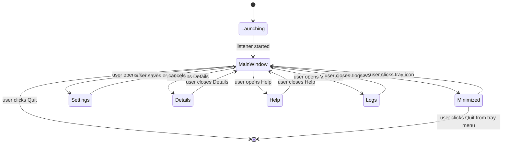

# UX Spec — Tray App

Read `02-process/bpmn-user-workflow.md` first for the lifecycle this UI implements. This document defines the specific screens, states, and controls.

## App states

## Screens

### 1. Main window

The default view when the app is open.

**Contents:**
- Compact window sized for status, configuration summary, and actions only.
- App logo, using the project icon asset.
- Status indicator: listener running (green) with the current HTTP listener shown, e.g. "Listening on 127.0.0.1:8080"
- Runtime details: active Physical/Virtual destination, default printer
  address/port, and allowed origins. If no origins are configured, show a clear
  empty state and point the user to Settings. Do not repeat the listener
  address here; the status row already owns listener status.
- Non-affiliation disclaimer, always visible, short form: "print-bridge is an independent project, not affiliated with or endorsed by any printer manufacturer." (full text in `09-legal/disclaimer.md`)
- Buttons/links: **Settings**, **Open Inspector**, **Details**, **Help**,
  **View Logs**, **Quit**

**Close button behavior:** clicking the window's close control **minimizes to
tray**, it does not quit. On the first close during each app run, the app
notifies the user that it is still running in the tray and how to reopen or
quit.

### 2. Settings

Opened from the main window. See `06-config/config-schema.md` for the exact fields and validation rules; this section covers the screen behavior only.

**Contents:**
- Destination selector: Physical or Virtual (capture only).
- HTTP port (numeric input)
- Default printer port (numeric input, pre-filled with 9100)
- Default printer address (optional text input — a convenience default, not a saved profile list; see ADR scope note below)
- CORS allowed origins (one origin per line in a multiline field; empty by
  default)
- Optional Labelary preview enablement, with a disclosure that full label
  contents are sent to the external service, plus label width/height and
  density fields.
- Tooltip-style helper text for every setting. The helper text should explain what the setting means in user-facing language without requiring documentation lookup.
- **Save** and **Cancel** buttons

**Save behavior:**
- Validate all fields when Save is selected; show validation errors inline and
  preserve entered values without saving invalid settings.
- On Save, persist to the config file and trigger the HTTP listener restart described in `03-architecture/architecture-overview.md`.
- Show a brief confirmation (e.g. "Settings saved — listener restarted on port 8080") so the user has positive feedback that the restart happened.
- **Cancel** discards changes and returns to the main window without touching the running listener.

### 3. Details

Opened from the main window. Displays all user-relevant runtime/configuration information in a read-only view with normal foreground contrast. This screen is the diagnostic/support bundle, so the content should be easy to read when troubleshooting an installation.

- App name and app ID.
- Listener running/stopped state, listener address, HTTP port, and last listener error.
- Current destination (Physical or Virtual).
- Default printer address and default printer port.
- Allowed CORS origins.
- Config file path and log file path.
- API endpoints, including the Inspector URL.
- TCP timeout values and log rotation policy.

### 4. Help

Opened from the main window or tray/menu bar. Help is a first-class screen, separate from Details, focused on setup and troubleshooting instead of raw diagnostics. Its language is for a normal user, not a developer.

**Contents:**
- Current listener, default printer address/port, and allowed-origin summary.
- Current Physical/Virtual destination, whether jobs are being captured or
  sent to a printer, and the optional Labelary data-sharing behavior.
- What to check when nothing prints.
- What to check when the website cannot connect.
- Printer IP address or hostname guidance.
- Printer port guidance.
- Allowed origin guidance using website-address language, including that an allowed origin is different from the printer IP address.
- Common failure checks: printer power/network, exact origin match, printer address/port, VPN, firewall, logs, and the Details screen.
- Support and feedback note with Jaime Bolaños, `https://jbolanos.dev`, and GitHub: `https://github.com/JamesBolanos`. Tone should be helpful and confident, not a sales pitch.

### 5. Logs viewer

Opened from the main window. Displays the current rotating log file's contents as a live activity view (see `03-architecture/architecture-overview.md` for rotation policy).

- Read-only normal-contrast text view, most recent entries first, with a clear label that states the order and that the view updates automatically.
- No in-window action buttons; updates happen automatically while the window is open.
- No in-app filtering/search required for the current beta — this is a lightweight troubleshooting view, not a log management tool.

### 6. Tray/menu bar icon

Persistent while the app is running (whether the main window is open or minimized).

**Left-click / click:** opens or focuses the main window.

**Right-click menu (or platform-equivalent):**
- Open print-bridge (same as click)
- Details
- Help
- Open Inspector
- Status: shows a non-interactive line, e.g. "HTTP: 127.0.0.1:8080" or "Stopped" if the listener failed to start
- Destination: Physical or Virtual (capture only)
- Default printer port
- Allowed origin count
- Quit

## States to handle explicitly

| State | UI behavior |
|---|---|
| Listener fails to start (e.g. port already in use) | Main window shows a clear error with the specific reason and a shortcut to Settings to change the port. Tray icon still appears (so the user isn't left with no way to reach the app) but its status line reflects "Stopped." |
| Settings save triggers restart, restart fails | Show the same error pattern as above, inline in the Settings screen, without discarding the user's entered values (so they don't have to retype). |
| First launch | No special onboarding flow required for the current beta. The listener can start immediately, but browser web apps cannot call it until the user adds the required origin(s) in Settings. |
| Invalid or ambiguous saved configuration (VM-3) | Leave the original file untouched and the listener stopped. Show the repair reason and config path in the main window and Settings; disable Settings Save. Repair the file and restart the app. Displayed defaults are not an active Physical configuration. |
| Valid Virtual configuration (VM-4/VM-8) | Start the listener with local capture. The main window and tray identify Virtual mode; switching modes preserves printer address/port. |

## Explicitly out of scope for the current beta

- No saved multi-printer profile list — the "default printer address" field is a single convenience value, not an address book (see BRD out-of-scope, BR/ADR references).
- No in-app update checker/notification.
- No dark/light theme toggle — follow the OS theme automatically if Fyne provides this for free; do not build custom theming.

## Virtual Mode and browser inspector

Status: approved for the [Virtual Mode sprint](../08-backlog/virtual-mode-sprint.md).
VM-3 persistence, VM-5 inspector APIs, the VM-6 local browser dashboard, VM-7
previews, VM-8 desktop integration, and VM-9 integration coverage are
implemented. Interactive macOS/Windows browser, tray, and installer smoke
checks remain release follow-up; they have not been reported as passed.

### Settings and mode visibility

- The Settings destination selector offers Physical and Virtual (capture only).
  Physical remains the default; saved address/port values are retained when
  switching modes.
- The main window and tray show the active destination. Explain that Virtual
  mode captures all jobs, including requests specifying a physical printer.
- Settings exposes optional Labelary rendering, off by default, with a clear
  label-content sharing disclosure, width/height in inches, and print-density
  controls. External rendering operates only in Virtual mode.
- Preview settings do not modify source data. Enabling rendering applies to
  new jobs; old jobs require an explicit render/retry action.
- Preserve current Save/Cancel behavior and inline errors. Unsupported or
  ambiguous saved destination settings must not silently enable printing.

### Open Inspector

Open Inspector is available in the main window and tray. It opens the local
dashboard using the current HTTP port, with a recoverable error if the system
browser cannot be launched. Incoming jobs update the dashboard without
launching more tabs. Reusing an
existing tab is best effort; do not depend on controlling the browser remotely.
The launcher follows the current HTTP port. An old tab after a port change
shows a disconnected state and guidance to reopen from the app.

### Dashboard (VM-6 implemented)

The bundled dashboard is served from the existing loopback listener at
`/inspector/`. It refreshes the bounded job list every 2.5 seconds while open.
It does not launch browser tabs automatically; the desktop action is
user-initiated.

- A live newest-first job list with ID, received time, byte count, supplied
  destination metadata, and detected type. Empty state explains how to submit
  a job and that session history is temporary.
- A selected-job view with raw text, visible control-character/line-ending
  inspection, hex bytes, and a preview panel. These display modes must not
  change the original bytes used for downloads or rendering.
- Copy raw text, download original payload, and clear-history actions. Surface
  unavailable clipboard access and deleted/evicted selections clearly.
- Independent capture and preview statuses. Preview states include disabled,
  queued, rendering, ready, unsupported, and failed; failures explain how to
  retry without resubmitting the print job.
- Label-index selection and manual render/retry are available alongside PNG
  previews. Current label dimensions/density are snapshotted per attempt; a
  settings change invalidates old cached previews. A failed preview remains
  separate from capture success.
- Unknown/raw text stays inspectable without rendering. Unsupported commands
  or rendering failures do not invalidate a captured job.
- Offline capture, listing, inspection, copying, downloading, and clearing use
  local bundled assets. Online ZPL previews are unavailable offline. New jobs
  render automatically only when enabled; older jobs require an explicit
  render/retry action.

The existing View Logs window stays a request-metadata view. The inspector
holds payload history separately. Closing the browser leaves capture running;
quitting the desktop app ends the session and clears stored jobs. PDF viewing,
physical replay, and persistent history are deferred.
