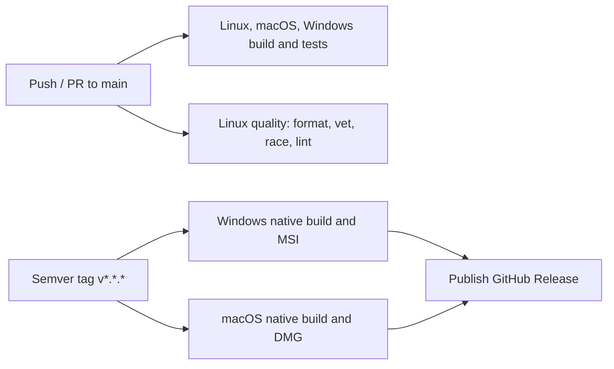

# Build Pipeline — print-bridge

Read `03-architecture/architecture-overview.md` first. This document describes the GitHub Actions setup needed to produce the current beta.

## Current workflows

The current repository has:
- Go module with the desktop app entry point, Gin HTTP server, CORS, config, logging, physical TCP print, and Virtual capture/inspection.
- `.github/workflows/go.yml` runs build/test on pushes and pull requests targeting `main`, on Linux, macOS, and Windows; Linux also runs formatting, vet, race, and lint checks.
- `.github/workflows/release-binaries.yml` builds the Windows MSI and macOS DMG on native runners for semver tags (`v*.*.*`), then publishes them as release assets.
- Optional Windows signing hook (`WINDOWS_SIGN_CERT_BASE64` / `WINDOWS_SIGN_CERT_PASSWORD` secrets) — **not used for the current beta** per `01-business/constraints.md`; leave the hook in place but unset, so signing can be turned on later without a workflow rewrite.
- Free macOS ad-hoc signing in the release workflow. This validates the `.app` bundle structure before packaging the DMG, without requiring Apple Developer Program membership.

## Architecture evolution from the earlier prototype

| Area | Earlier prototype | Current beta |
|---|---|---|
| Entry point | Headless HTTP server only | Fyne GUI app with embedded HTTP server (single binary, per `03-architecture/architecture-overview.md`) |
| Config | `ALLOW_ORIGINS` env var | `config.json` file (see `06-config/config-schema.md`); Settings UI is the primary path |
| Printer port | Hardcoded `9100` | Configurable per-request via `/print`, with `defaultPrinterPort` in config as a UI convenience (see `04-api/openapi.yaml`) |
| Build output | Raw binary in a zip | Platform installer: `.msi` (Windows), `.dmg` (macOS) — see platform-specific docs below |
| Timeouts | None (unbounded `net.Dial`/`Write`) | Explicit connect/write timeouts per `03-architecture/architecture-overview.md` |
| Logging | None | Rotating local log file |
| Endpoints | `/ping`, `/print` | `/ping`, `/print`, `/status`, and protected Virtual inspector routes |

## CI/CD pipeline

- Fyne requires CGO and platform-specific native GUI libraries. The release
  workflow builds Windows and macOS binaries on their native GitHub-hosted
  runners rather than cross-compiling.
- Packaging (`.msi`/`.dmg`) happens after the binary is built, per platform. See the platform-specific installer docs for tool choices.
- No Windows signing step runs unless the Windows signing secrets are present. The macOS workflow ad-hoc signs and verifies the `.app` bundle before creating the DMG. It does not use paid Developer ID signing or notarization.

## Versioning

The [testing plan](testing.md) inventories automated coverage and records the
Virtual Mode sprint checks. The dashboard assets are embedded in the Go
application; server tests verify the bundled HTML, JavaScript, and CSS, and the
native CI matrix builds/tests the application on Linux, macOS, and Windows.
The release workflow packages the built application in the macOS DMG and
Windows MSI. Native builds alone do not verify tray interaction, browser
launch behavior, or an installed package; those smoke checks remain manual.

Keep the existing semver-tag-triggers-release pattern (`v*.*.*`). No change needed here — it already fits a small solo project well.

## What this document does not cover

- Exact installer tooling/steps — see `installer-windows.md` and `installer-macos.md`.
- What the user sees/does when opening an unsigned installer — also in those two files.
