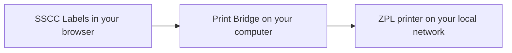

# Print from SSCC Labels with Print Bridge

Use this guide to install Print Bridge and send a saved label from [SSCC Labels](https://sscc-labels.com) to a ZPL-compatible printer on your local network. It describes Print Bridge v1.0.0-beta.4 and later.

## How web printing works



SSCC Labels prepares the saved label as ZPL, the printer's command language. Your browser sends that text to Print Bridge on the same computer. The bridge forwards it to the printer's network address. Keep the bridge running while you print.

You need a supported computer, a ZPL-compatible network printer with matching label stock, and the printer's IP address or hostname. Find that address and the printer resolution in its network/configuration report or ask the person who manages it. A USB-only printer is not supported by this network-printing flow.

## 1. Install and open Print Bridge

Open the [latest GitHub release](https://github.com/JamesBolanos/print-bridge/releases/latest) and expand **Assets**. Choose an installer, rather than the source-code archives:

| Computer | Download |
| --- | --- |
| Mac with Apple silicon | `print-bridge-darwin-arm64.dmg` |
| Windows 64-bit (x64) | `print-bridge-windows-amd64.msi` |

### macOS

1. Open the downloaded DMG.
2. Drag **print-bridge** into **Applications**.
3. Eject the disk image and open **print-bridge** from Applications.

The current beta is not notarized by Apple. If macOS blocks an unidentified developer, and you trust the download from this project's release page, use **System Settings → Privacy & Security → Open Anyway** after attempting to open it. See [Apple's instructions](https://support.apple.com/en-ie/102445). For a damaged-app message, see the project's [macOS installation troubleshooting](07-build-deploy/installer-macos.md#what-the-user-will-see).

### Windows

1. Open the MSI and follow the installation prompts. Installation may require administrator permission.
2. Open **print-bridge** from the Start menu or Desktop shortcut.

The current beta may show a SmartScreen warning. If you trust this project's download, **More info → Run anyway** may be available. If your organization's policy blocks installation, ask its administrator. See [Windows installation details](07-build-deploy/installer-windows.md#what-the-user-will-see).

The bridge starts its listener when opened. Look for **Listening on 127.0.0.1:8080**. Closing the window hides it in the tray/menu bar; **Quit** stops it. Open it again after restarting your computer—it does not start automatically.

## 2. Configure the bridge

In the desktop app, open **Settings**:

- Set **Destination** to **Physical** for paper output. **Virtual (capture only)** records jobs locally without sending them to a printer.
- Keep **HTTP port** at `8080`, unless another app uses it.
- Under **Allowed origins**, check for these two entries, one per line:

  ```text
  https://sscc-labels.com
  https://www.sscc-labels.com
  ```

- Click **Save** and confirm that the listener is running.

Fresh installations of v1.0.0-beta.4 or later include both origins. Upgrades preserve your saved settings, including an empty or custom allow-list; add missing origins without removing other entries you still need. An origin is the website address without a page path such as `/settings`.

The bridge's **Default printer address** is optional. For SSCC Labels, enter the actual printer address in the website's settings below: the website supplies the destination with each job. Optional Labelary previews are not needed for printing; leave them off unless you want Virtual-mode rendering that sends label contents to that service.

## 3. Configure SSCC Labels

Sign in and open **Settings → LAN printer**. If this section is unavailable, that website deployment does not yet include bridge printing; PDF and ZPL downloads remain available.

| Website setting | What to enter |
| --- | --- |
| **Bridge address** | `127.0.0.1` (this computer). This is different from your printer's IP. |
| **Bridge HTTP port** | `8080`, or the HTTP port saved in the desktop app. |
| **Printer IP address or hostname** | The printer's LAN address, for example `192.168.1.100`. Replace the example with your printer's actual address. |
| **Printer TCP port** | Usually `9100`; confirm it in your printer's configuration. |
| **Printer resolution** | Match the printer: `203`, `300`, or `600` dpi. |

Choose **Test bridge connection**. Allow local network access if your browser asks. A successful test confirms that the browser can reach the bridge; it does not test the printer or produce a label.

Choose **Save printer settings**. These settings belong to your SSCC Labels account and are shared across computers. Each computer you print from needs its own running bridge and access to the configured printer. Printer settings save separately from the GS1 Company Prefix and SSCC sequence.

## 4. Print your first saved label

1. Load matching label stock and make sure the printer is ready.
2. Open **Saved labels** in SSCC Labels and find a saved label, or generate and save one first.
3. Choose **Print via bridge** once and wait for the result.
4. Check the printed size, text, and barcode with your scanner before operational use.

Printing uses the resolution saved in Settings. The **ZPL printer resolution** selector in Saved labels controls file downloads. Sending a label again prints another copy with the same SSCC; it does not allocate a new one.

**Sent to the printer** means the bridge acknowledged delivery, not that paper output or barcode quality has been verified. **Captured … in Virtual mode** means no physical label was printed. If delivery cannot be confirmed, check the printer before trying again: a timeout can happen after it received the job. There is no automatic retry.

## Troubleshooting

| What you see | What to check |
| --- | --- |
| Cannot reach the bridge | Open the desktop app, confirm it is listening, and match the website's bridge HTTP port. Check Allowed origins and the browser's local-network permission for this site. |
| Listener stopped / port in use | Choose an unused HTTP port in bridge Settings, save, and use the same port in SSCC Labels. Keep the listener on this computer. |
| Bridge test succeeds, but no paper comes out | Check Physical mode, printer address/TCP port, network reachability, label stock, and printer errors. The bridge test checks only the local app. |
| Virtual capture message | Switch the bridge's Destination to Physical and save before sending a job intended for paper output. |
| Wrong size, clipped label, or unreadable barcode | Match the saved DPI, media, and printer width to the label. A 6 × 8 label needs a printer with at least six-inch print width. |
| Works on one computer only | Install/open the bridge on the other computer, allow browser local-network access there, and verify it can reach the same LAN printer. |
| Delivery could not be confirmed | Inspect the printer/output before explicitly retrying to avoid duplicate labels. Use the bridge's **View Logs** for connection errors. |

For further help, open **Help**, **Details**, or **View Logs** in Print Bridge, or [report an issue](https://github.com/JamesBolanos/print-bridge/issues). Include your OS, bridge version, and the error message; omit private label contents and addresses.

## Updating later

Quit the running bridge, install the new release, and open it again. Your configuration is stored separately from the app and is preserved:

- macOS: `~/Library/Application Support/PrintBridge/config.json`
- Windows: `%APPDATA%\PrintBridge\config.json`

